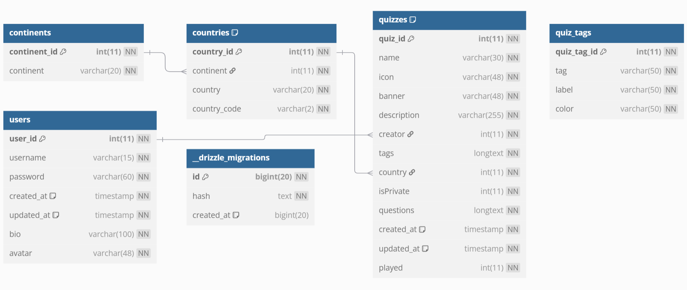
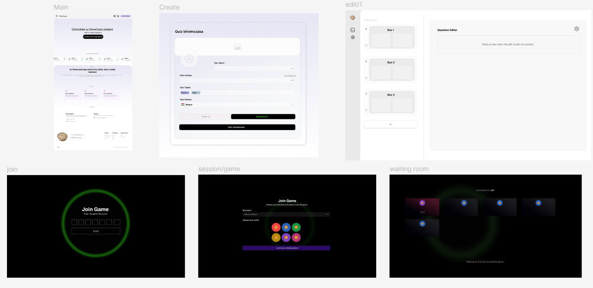
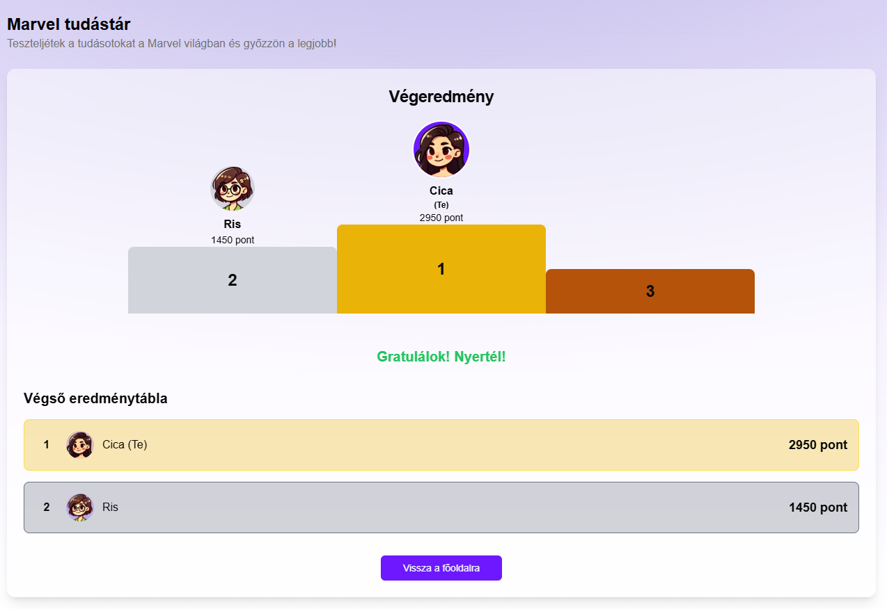
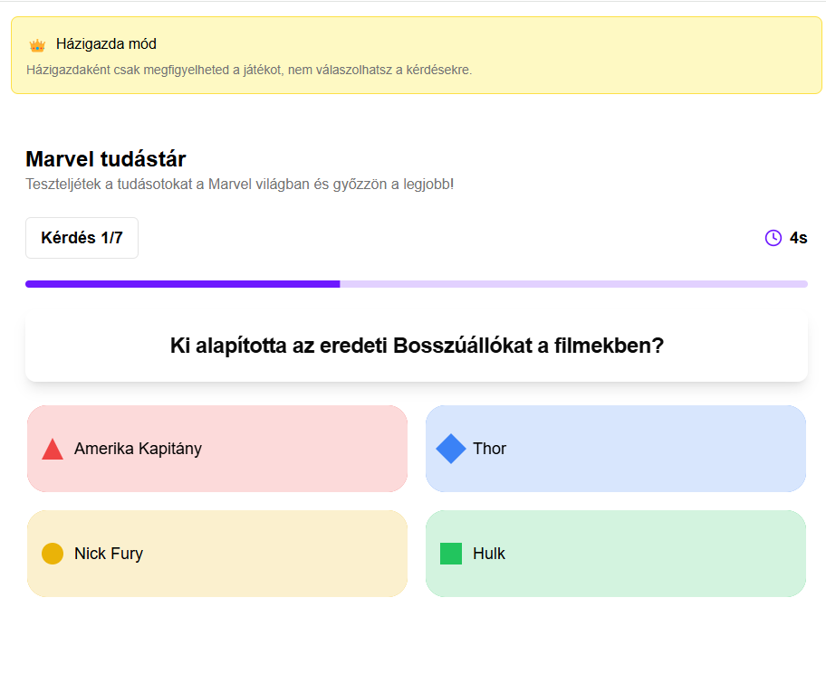
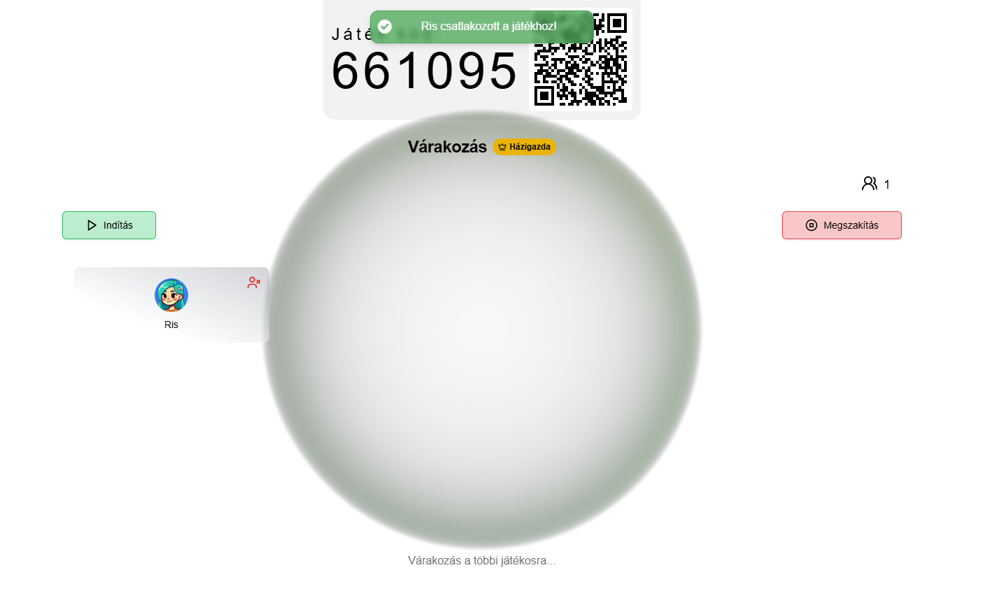
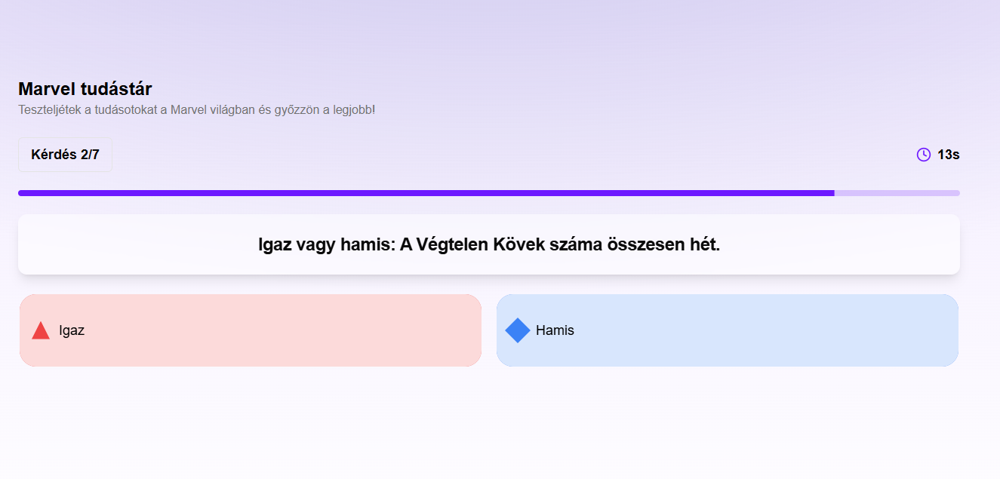

# Elmecsata.hu - Szakdolgozat

Az Elmecsata egy online kvízjáték alkalmazás, amely a technikusi tanulmányok szakdolgozataként készült. A projekt célja egy a Kahoot-hoz hasonló, de modernebb és bővíthetőbb rendszer létrehozása volt, amely egyszerre szolgál szórakoztatásra és tanulásra.

## Főbb funkciók

- **Kvíz editor** – új kvízek létrehozása, kérdések szerkesztése, borítókép, címkék, leírás, nyelvi beállítások  
- **Valós idejű játék (real-time)** – házigazda indítja a játékot, a játékosok kóddal csatlakoznak, pontozás és pódium megjelenítés  
- **Megosztás** – kvízek publikus linkkel vagy privát módon is megoszthatók  
- **Lobby rendszer** – a játék előtt a résztvevők belépnek, várakoznak a startig  
- **Emote küldés** – játék közben lehetőség van reakciók/emote-ok küldésére  
- **Többféle kérdéstípus** – feleletválasztós, igaz/hamis, szavazás, információs „slide”  
- **Profil és felhasználói fiók** – regisztráció, bejelentkezés, saját kvízek kezelése  

<a href="https://elmecsata.hu/docs.pdf">Teljes szakdolgozat dokumentáció</a>

| | | |
|---|---|---|
|  |  |  |
|  |  |  |

